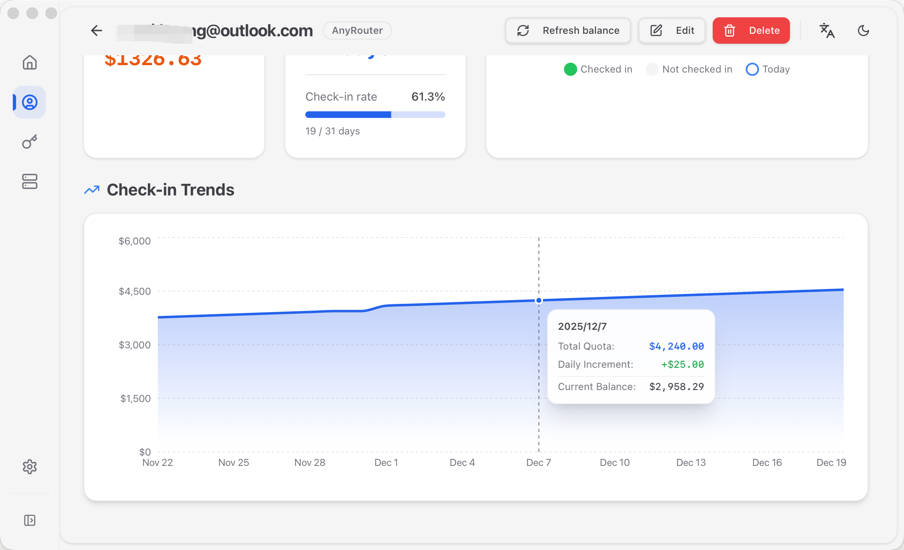

# Check-in Streaks & Statistics

The Check-in Streaks feature provides detailed check-in history, streak statistics, and visual analysis to help you track your check-in habits and earnings.



## Feature Overview

- 📊 **Streak Statistics** - Current streak days, longest streak record
- 📅 **Calendar View** - Visual display of monthly check-in status
- 📈 **Trend Analysis** - Recent days (30 days on the account overview, 90 days on the account activity page)
- 💰 **Earnings Tracking** - Balance increment for each check-in, distinguishing **Confirmed** from **Inferred**
- 📝 **History & Statistics** - Result, failure reason, duration, and per-period success rate of every attempt
- 🎯 **Per-Account View** - View individual account or all accounts

> Every check-in day has a **source**: `Confirmed` (a provider response, or a check-in you recorded manually) or `Inferred` (derived from a quota increase — see "How a check-in record is created" below). Inferred values are marked in the interface so they are never mistaken for a provider confirmation.

## Page Navigation

1. Click **Check-in Streaks** in the sidebar to enter the page
2. Use the account selector in the top right to switch views:
   - **All Accounts** - View overview of all accounts
   - **Individual Account** - View detailed records for a specific account

## All Accounts View

### Overview Cards

Display all accounts grouped by service provider:

| Display Content | Description |
|----------------|-------------|
| Account Name | Display name of the account |
| Last Check-in | Most recent check-in date |
| Current Streak | Current consecutive check-in days |
| Longest Streak | Historical longest consecutive days |
| Total Days | Cumulative total check-in days |

### Actions

- **Click Card** - Switch to detailed view for that account

## Individual Account View

After selecting a specific account, you can view detailed check-in records and statistics.

### Account Overview Panel

The left panel displays key statistics for the account:

#### Basic Information
- Account name
- Service provider
- Last check-in date

#### Streak Statistics
- **Current Streak** 🟠 - Current consecutive check-in days
- **Longest Streak** 🟡 - Historical longest consecutive days
- **Total Days** 🔵 - Cumulative total check-in days

#### Monthly Statistics
- **Check-in Days** - Days checked in this month / Days elapsed this month
- **Check-in Rate** - Days checked in ÷ Days elapsed this month (days that have not arrived yet are excluded from the denominator)
- **Earnings Increment** - Total check-in earnings this month (USD)

### Check-in Calendar

The right calendar displays monthly check-in status:

#### Date Markers
- 🟢 **Green** - Checked in (shows earnings increment)
- ⚪ **Gray** - Not checked in
- 🔵 **Blue Border** - Today

#### Calendar Operations
- Click **Previous/Next Month** buttons to switch months
- Click on a date to view details for that day

### Check-in Trend Chart

Displays the recent check-in trend (30 days on the account overview, 90 days on the account activity page):

- **X-axis** - Date
- **Y-axis** - Earnings increment (USD)
- **Data Points** - Daily check-in earnings; a date without a snapshot of its own carries the most recent balance reading forward, so the line never breaks
- **Trend Line** - Visual display of earnings changes

## View Check-in Details

Click on a date in the calendar to open a details dialog:

| Field | Description |
|-------|-------------|
| Date | That check-in day (the provider's quota day, not the UTC day) |
| Status | Checked in / Not checked in |
| Balance Increment | Balance increase from this check-in |
| Reward Source | Provider confirmation / Inferred (derived from a quota increase) |
| Current Balance | Last balance reading of that day |
| Daily Consumption | Consumption increase relative to the previous day |
| Total Consumption | Cumulative consumption up to that day |
| Total Quota | Cumulative quota up to that day |

If this day belongs to a provider you can only check in on the website, and you did check in on the website, you can record it manually here (this requires the provider to have a known fixed reward rule).

## How a check-in record is created

A check-in record can come from five kinds of source, and the interface distinguishes them:

| Source | When it is created | Trust |
|--------|--------------------|-------|
| Provider response | Automatic or manual check-in where the provider confirms it in the response | Confirmed |
| Provider rule | The provider confirms the check-in but reports no amount, while its daily reward is known and fixed (e.g. $25 on AnyRouter) | Confirmed |
| Provider says "already checked in" | A repeated request is refused by the provider as "already checked in" | Confirmed |
| Balance delta | That day's quota is higher than the previous check-in day and no more trustworthy record exists | Inferred |
| Manual | You confirm "I checked in on the website" in the day details | Manual (treated as Confirmed) |

**How inference works**: every time the app reads a balance (a manual refresh, opening a related page, or background polling), it compares the quota at that moment with the previous quota day that has a check-in; a clear increase is recorded as an Inferred record. As a result, **accounts you can only check in on the website are still recorded automatically** — as long as the app is running.

**At most one record per day**, and the source only ever moves up: Manual > Provider response > Provider rule > Balance delta > Legacy estimate. So when more trustworthy information arrives later, an existing Inferred record is upgraded; the reverse never happens.

**Note**: a quota increase can also be a top-up or a grant, and those are recorded as an Inferred check-in day too. Inferred records are always marked in the interface; if you are sure a day was not a check-in, handle it as described in the common questions below.

## Streak Rules

### Streak Calculation Rules

1. **Start Streak** - Once a day has a check-in record, the streak starts at 1
2. **Maintain Streak** - Two adjacent days both have a record, streak days +1
3. **Break Streak** - A whole day passes with no record, streak resets to zero
4. **Determining the current streak** - A streak only counts as "current" while its last record is **today or yesterday**; a streak that ended earlier is kept as history and no longer shown as current
5. **Longest Record** - Automatically tracks historical longest streak days

### Streak Example

```
Date:    1st  2nd  3rd  4th  5th  6th  7th
Checked: ✓    ✓    ✓    ✗    ✓    ✓    ✓
Streak:  1    2    3    0    1    2    3
Longest: 1    2    3    3    3    3    3
```

If there are no further records after the 7th, then on the 9th the Current streak is 0 (the streak ended on the 7th) while the Longest streak is still 3.

## Check-in Rate Calculation

Check-in Rate = (Days checked in this month / Days **elapsed** this month) × 100%

**Example** (30 days this month, today is the 20th):

- 15 days checked in
- Check-in Rate = (15 / 20) × 100% = 75%

Days that have not arrived yet are excluded from the denominator, so the rate does not look artificially low mid-month.

## Earnings Tracking

### Single Check-in Earnings

Each check-in's earnings are displayed below the calendar date:

```
15
+$0.50
```

### Monthly Earnings

Monthly statistics show total earnings from all check-ins this month:

```
Earnings Increment: $12.50
```

### Trend Analysis

Through the trend chart you can observe:
- Daily earnings changes
- Earnings differences between providers
- Earnings stability

## Usage Tips

### Build Check-in Habits

1. **Set Auto Check-in**
   - Edit account, enable auto check-in
   - Set appropriate check-in time (e.g., 8:00 AM)

2. **Regular Monitoring**
   - Check the streaks page weekly
   - Ensure no missed check-ins
   - Monitor streak day changes

3. **Track Goals**
   - Set consecutive check-in goals (e.g., 30 days, 90 days)
   - Use calendar to track progress

### Optimize Earnings

1. **Analyze Trends**
   - Observe which accounts have higher earnings
   - Focus on earnings change trends

2. **Handle Failures Promptly**
   - View details for failed dates
   - Adjust configuration based on error messages

3. **Multi-Account Management**
   - Use all accounts view to monitor overall situation
   - View individual accounts that need attention

## Data Statistics

### Available Metrics

| Metric | Description | Location |
|--------|-------------|----------|
| Current Streak | Current consecutive check-in days | Account overview |
| Longest Streak | Historical longest consecutive days | Account overview |
| Total Days | Cumulative total check-in days | Account overview |
| Monthly Check-ins | Check-in days this month | Monthly stats |
| Check-in Rate | Check-in rate this month | Monthly stats |
| Monthly Earnings | Total earnings this month | Monthly stats |

### Cross-Month Streaks

Streak calculation rules across months:
- December 31 check-in + January 1 check-in = Streak maintained
- Missing any day = Streak broken

## Common Questions

### Q: Why did my streak reset to zero?

**A**: Possible reasons:
- A day has no check-in record at all (neither manual nor automatic succeeded)
- The streak ended two or more days ago: **the current streak only counts a streak that is still running today or yesterday**, and a streak that ended earlier is kept in the longest streak instead
- The app wasn't running for a long time and that provider can only be checked in on the website (these accounts rely on the app reading the balance to discover the check-in)

### Q: What does "checked in (inferred)" mean?

**A**: It means the app did not get a confirmation from the provider and instead derived the check-in from a quota increase: that day's quota is higher than the previous check-in day. This is common for providers you can only check in on the website, or when your check-in happened outside the app. Top-ups and grants can produce the same increase, which is why inferred values are marked in the interface.

### Q: How are providers I can only check in on the website recorded?

**A**: There are two ways:
1. Keep the app running — for these providers the app reads the balance once every 6 hours and records an Inferred record whenever it sees a quota increase;
2. Open that day in the calendar and record it manually (this requires the provider to have a known fixed reward rule).

These providers never receive an "auto check-in request", so they do not count as failures and do not produce noise in the logs.

### Q: Why is the "last check-in" time different from when I actually checked in?

**A**: It shows **the time the app recorded this check-in**. For an inferred record that is the moment the app read the balance, which can be later than the moment you clicked on the website (by up to one polling interval). If the time in the account list carries a `*`, it comes from inference.

### Q: What is the minimum retry interval?

**A**: It is the **shortest wait between attempts after a failure**. It only paces retries and no longer decides "can I check in today" — whether today is already done is decided by the check-in record itself. Setting it to 0 means using the built-in 30 minutes. Consecutive failures back off exponentially (30 minutes → 1 hour → 2 hours → 4 hours, capped at 6 hours) and never cross into the next check-in day.

### Q: What if a provider keeps failing?

**A**: Open that account's History to see the result, the failure reason code, and the duration of every attempt. Common reasons: network unreachable, request timeout, provider requires verification (WAF), provider rejects the request (4xx), provider temporarily unavailable (5xx). A permanent failure (4xx, or the provider does not support auto check-in) is not retried again that day; retryable failures are retried with backoff.

### Q: How long are check-in records kept?

**A**: Check-in records are permanently saved in the local database and won't be automatically cleared.

### Q: Can I modify historical check-in records?

**A**: Manual modification of historical records is not currently supported. All records are automatically generated by the system.

### Q: Why do some dates not have earnings increments?

**A**: Possible reasons:
- Check-in failed
- Provider didn't provide earnings that day
- Failed to get balance information

### Q: Why does the trend chart not cover a fixed 30 days?

**A**: To keep the chart clear and readable, the account overview shows the most recent 30 days and the account activity page shows the most recent 90 days. Custom time ranges may be supported in future versions.

### Q: Can I export check-in records?

**A**: Export functionality is not currently supported, planned for future versions.

## Tips & Suggestions

### Improve Check-in Success Rate

1. **Keep App Running**
   - Auto check-in requires app to be running
   - Recommend setting startup on boot

2. **Check Network**
   - Ensure network is normal during check-in
   - Check proxy settings

3. **Update Credentials**
   - Update cookies promptly when expired
   - Regularly check account status

### Make Full Use of Statistics

1. **Set Goals**
   - Track consecutive check-in days
   - Set monthly earnings goals

2. **Comparative Analysis**
   - Compare performance of different accounts
   - Analyze reasons for earnings changes

3. **Optimize Strategy**
   - Adjust check-in time based on statistics
   - Focus on high-value accounts

## Related Documentation

- [Check-in Operations](./check_in_operations.md) - Learn how to perform check-ins
- [Account Management](./account_management.md) - Manage accounts and auto check-in
- [Balance Tracking](./balance_tracking.md) - View balance changes
