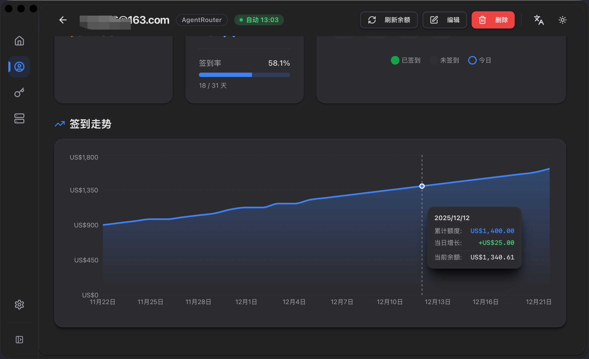

# 签到记录与统计

签到记录功能提供详细的签到历史、连续签到统计和可视化分析，帮助你跟踪签到习惯和收益情况。



## 功能概览

- 📊 **连续签到统计** - 当前连续天数、最长连续记录
- 📅 **日历视图** - 直观显示每月签到情况
- 📈 **趋势分析** - 最近的天数（账号总览 30 天、账号活动页 90 天）
- 💰 **收益追踪** - 每次签到的额度增量，并区分「服务商确认」与「推断」
- 📝 **历史与统计** - 每次尝试的结果、失败原因、耗时与周期成功率
- 🎯 **按账号查看** - 支持查看单个账号或所有账号

> 每个签到日都有**来源**：`确认`（服务商回执或你手动补记）或 `推断`（从额度上涨反推，见下文「签到记录是怎么产生的」）。推断值在界面上会带标记，避免被当成服务商确认的结果。

## 页面导航

1. 从侧边栏点击 **签到记录** 进入页面
2. 使用右上角的账号选择器切换视图：
   - **所有账号** - 查看所有账号的签到概览
   - **单个账号** - 查看特定账号的详细记录

## 所有账号视图

### 概览卡片

按服务提供商分组显示所有账号：

| 显示内容 | 说明 |
|---------|------|
| 账号名称 | 账号的显示名称 |
| 最后签到 | 最近一次签到日期 |
| 当前连续 | 当前连续签到天数 |
| 最长连续 | 历史最长连续签到天数 |
| 总签到天数 | 累计签到总天数 |

### 操作

- **点击卡片** - 切换到该账号的详细视图

## 单个账号视图

选择特定账号后，可以查看详细的签到记录和统计。

### 账号概览面板

左侧面板显示账号的关键统计：

#### 基本信息
- 账号名称
- 服务提供商
- 最后签到日期

#### 连续签到统计
- **当前连续** 🟠 - 当前连续签到天数
- **最长连续** 🟡 - 历史最长连续天数
- **总签到天数** 🔵 - 累计签到总天数

#### 本月统计
- **签到天数** - 本月已签到天数 / 本月已过天数
- **签到率** - 已签到天数 ÷ 本月已过天数（未到来的日期不计入分母）
- **额度增量** - 本月签到总额度（美元）

### 签到日历

右侧日历显示每月的签到情况：

#### 日期标记
- 🟢 **绿色** - 已签到（显示额度增量）
- ⚪ **灰色** - 未签到
- 🔵 **蓝色边框** - 今天

#### 日历操作
- 点击 **上月/下月** 按钮切换月份
- 点击日期查看当天详情

### 签到趋势图

显示最近的签到趋势（账号总览 30 天，账号活动页 90 天）：

- **横轴** - 日期
- **纵轴** - 额度增量（美元）
- **数据点** - 每天的签到收益；没有当天快照的日期会沿用最近一次的余额读数，不会断线
- **趋势线** - 直观显示收益变化

## 查看签到详情

点击日历中的日期，弹出详情对话框：

| 字段 | 说明 |
|-----|------|
| 日期 | 该签到日（服务商的重置日，不是 UTC 日） |
| 状态 | 已签到 / 未签到 |
| 额度增量 | 本次签到的额度增加 |
| 奖励来源 | 服务商确认 / 推断（从额度上涨反推） |
| 当前余额 | 当天最后一次读数 |
| 当日消耗 | 相对前一天的消耗增量 |
| 累计消耗 | 截至当天的累计消耗 |
| 累计额度 | 截至当天的累计额度 |

如果这一天是「只能网页签到」的服务商，且你在网页上完成了签到，可以在这里手动补记（需要服务商有已知的固定奖励规则）。

## 签到记录是怎么产生的

一条签到记录有五种来源，界面会区分它们：

| 来源 | 何时产生 | 可信度 |
|-----|---------|--------|
| 服务商回执 | 自动/手动签到，服务商在响应里确认 | 确认 |
| 固定规则 | 服务商确认签到、但没回报金额，而它的每日奖励是已知固定的（如 AnyRouter 的 $25） | 确认 |
| 服务商表示「今天已签到」 | 重复请求被服务商回绝为「已经签到」 | 确认 |
| 额度上涨推断 | 当天额度比上一个签到日高，且没有更可信的记录 | 推断 |
| 手动补记 | 你在日期详情里确认「我在网页上签过了」 | 手动（视同确认） |

**推断是怎么工作的**：每当应用读取一次余额（手动刷新、打开相关页面，或后台轮询），都会把当时的额度与上一个签到日比较；有明显上涨就记一条推断记录。因此**「只能网页签到」的账号也能被自动记录**——只要应用在跑。

**每天至多一条记录**，来源之间只升不降：手动补记 > 服务商回执 > 固定规则 > 额度推断 > 旧数据估算。所以后来读到更可信的信息时，已有的推断会被升级，反之不会。

**注意**：额度上涨也可能是充值或赠送，这类情况同样会被记成推断的签到日。推断记录在界面上一律带标记；如果你确认某天不是签到，目前需要按下面的常见问题处理。

## 连续签到规则

### 连续计算规则

1. **开始连续** - 某天有签到记录，连续从 1 开始
2. **保持连续** - 相邻两天都有记录，连续天数 +1
3. **中断连续** - 中间有整天没有记录，连续归零
4. **当前连续的判定** - 只有当最后一条记录是**今天或昨天**时，才算「当前连续」；更早结束的连续会被记为历史，不再显示为当前
5. **最长记录** - 自动追踪历史最长连续天数

### 连续签到示例

```
日期:    1日  2日  3日  4日  5日  6日  7日
签到:    ✓    ✓    ✓    ✗    ✓    ✓    ✓
连续:    1    2    3    0    1    2    3
最长:    1    2    3    3    3    3    3
```

若 7 日之后再无记录，到 9 日时「当前连续」为 0（因为连续在 7 日结束），但「最长连续」仍为 3。

## 签到率计算

签到率 = 本月已签到天数 ÷ 本月**已过**天数 × 100%

**示例**（本月 30 天，今天是 20 日）：

- 已签到 15 天
- 签到率 = 15 ÷ 20 × 100% = 75%

尚未到来的日期不计入分母，所以月中看不会显得偏低。

## 收益追踪

### 单次收益

每次签到的收益显示在日历日期下方：

```
15
+$0.50
```

### 月度收益

月度统计显示本月所有签到的总额度：

```
额度增量: $12.50
```

### 趋势分析

通过趋势图可以观察：
- 收益的日常变化
- 不同服务商的收益差异
- 收益的稳定性

## 使用技巧

### 养成签到习惯

1. **设置自动签到**
   - 编辑账号，启用自动签到
   - 设置合适的签到时间（如早上 8:00）

2. **定期检查**
   - 每周查看签到记录页面
   - 确保没有遗漏签到
   - 关注连续天数变化

3. **追踪目标**
   - 设定连续签到目标（如 30 天、90 天）
   - 使用日历跟踪进度

### 优化收益

1. **分析趋势**
   - 观察哪些账号收益更高
   - 关注收益变化趋势

2. **及时处理失败**
   - 查看失败日期的详情
   - 根据错误信息调整配置

3. **多账号管理**
   - 使用所有账号视图监控整体情况
   - 单独查看需要关注的账号

## 数据统计

### 可用统计指标

| 指标 | 说明 | 位置 |
|-----|------|------|
| 当前连续 | 当前连续签到天数 | 账号概览 |
| 最长连续 | 历史最长连续天数 | 账号概览 |
| 总天数 | 累计签到总天数 | 账号概览 |
| 月签到数 | 本月签到天数 | 月度统计 |
| 签到率 | 本月签到率 | 月度统计 |
| 月收益 | 本月总额度 | 月度统计 |

### 跨月连续

连续签到跨月计算规则：
- 12月31日签到 + 1月1日签到 = 连续保持
- 任何一天断签 = 连续中断

## 常见问题

### Q: 为什么连续天数归零了？

**A**: 可能的原因：
- 某天完全没有签到记录（手动或自动都没成功）
- 连续在两天或更早之前就结束了：**当前连续只统计「今天或昨天」还在延续的连续**，更早结束的连续会保留在「最长连续」里
- 应用长时间未运行，且该服务商只能网页签到（这类账号依赖应用读取余额来发现签到）

### Q: 某天显示「已签到（推断）」是什么意思？

**A**: 表示应用没有从服务商那里拿到确认，而是从额度上涨反推出来的：当天额度比上一个签到日高。常见于「只能网页签到」的服务商，或你的签到发生在应用之外。充值、赠送也可能造成同样的上涨，所以推断值在界面上带标记。

### Q: 只能网页签到、应用无法自动签到的账号怎么记录？

**A**: 有两种方式：
1. 保持应用运行——对于这类服务商，应用会每 6 小时读取一次余额，发现额度上涨就记一条推断记录；
2. 在日历里点开当天，手动补记（需要该服务商有已知的固定奖励规则）。

这类服务商不会有"自动签到请求"，所以不会计入失败，也不会产生垃圾日志。

### Q: 为什么「最后签到」显示的时间和我实际签到的时间不一样？

**A**: 显示的是**应用记录这条签到的时间**。对推断记录来说，那是应用读到余额的时刻，可能晚于你在网页上点击的时间（最长相差一次轮询间隔）。账号列表里的时间若带 `*`，说明它来自推断。

### Q: 「最小重试间隔」是做什么的？

**A**: 它是**失败后再次尝试之间的最短等待时间**，只影响重试节奏，不再决定"今天能不能签到"——今天是否已完成由签到记录本身判定。设为 0 表示使用内置的 30 分钟。连续失败时会按指数退避（30 分钟 → 1 小时 → 2 小时 → 4 小时，封顶 6 小时），并且不会跨到下一个签到日。

### Q: 某个服务商一直失败怎么办？

**A**: 打开该账号的「历史」可以看到每次尝试的结果、失败原因码与耗时。常见原因：网络不可达、请求超时、服务商要求验证（WAF）、服务商拒绝请求（4xx）、服务商暂时不可用（5xx）。永久性失败（4xx、该服务商不支持自动签到）当天不会再重试；可重试的失败会按退避重试。

### Q: 签到记录多久会被清除？

**A**: 签到记录永久保存在本地数据库中，不会自动清除。

### Q: 可以修改历史签到记录吗？

**A**: 目前不支持手动修改历史记录。所有记录由系统自动生成。

### Q: 为什么有些日期没有额度增量？

**A**: 可能的原因：
- 签到失败
- 服务商当天没有提供收益
- 获取余额信息失败

### Q: 趋势图为什么只显示 30 天？

**A**: 为了保持图表清晰易读，默认显示最近 30 天。未来可能支持自定义时间范围。

### Q: 可以导出签到记录吗？

**A**: 目前不支持导出功能，计划在未来版本中添加。

## 提示与建议

### 提高签到成功率

1. **保持应用运行**
   - 自动签到需要应用运行
   - 建议设置开机自启动

2. **检查网络**
   - 确保签到时网络正常
   - 检查代理设置

3. **更新凭证**
   - Cookie 过期及时更新
   - 定期检查账号状态

### 充分利用统计

1. **设定目标**
   - 追踪连续签到天数
   - 设定月度收益目标

2. **对比分析**
   - 对比不同账号的表现
   - 分析收益变化原因

3. **优化策略**
   - 根据统计调整签到时间
   - 关注高价值账号

## 相关文档

- [签到操作](./check_in_operations.md) - 了解如何执行签到
- [账号管理](./account_management.md) - 管理账号和自动签到
- [余额追踪](./balance_tracking.md) - 查看余额变化
